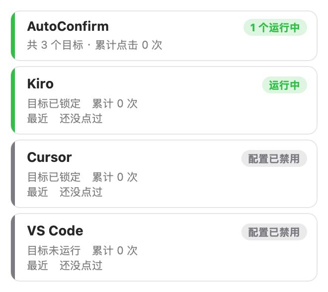

# AutoConfirm (AI_click)

macOS 菜单栏小工具，自动点击 AI 编程工具（Kiro / Cursor / VS Code）里的确认按钮，比如 Review changes 的 Accept、命令审批的 Allow，省去反复手动确认。

它通过 macOS 辅助功能（Accessibility / AXUIElement）读取目标应用的界面树，对命中规则的按钮直接发送 `AXPress`。不移动鼠标，也不需要窗口在前台，后台运行同样有效。



> ⚠️ 开启后，AI 的文件改动和要执行的命令会被自动批准。内置规则能拦下常见的危险操作，但无法覆盖所有情况，使用风险自负。建议在重要项目里先提交一次 git，留个干净的回退点。

## 功能

- 同时监控多个应用，每个目标在菜单栏里有独立的卡片、开关、点击计数
- 三层过滤，缺一不可：
  1. `deny_patterns`：按钮文字命中就绝对不点（Reject / Cancel / Delete …），优先级最高
  2. `allow_patterns`：只有命中这里的按钮才是候选（Accept / Allow / Run …）
  3. `dialog_markers`：按钮所在容器里必须出现弹窗特征文字，避免误点编辑器里的同名按钮
- 命令审查：
  - `command_deny_patterns`：`sudo`、`git push --force`、`curl | sh`、`terraform apply` 等命令直接拦下，留给你手动处理
  - `command_warn_patterns`：`rm -rf` 等照常放行，但会写进「风险命令记录」
- 后台页签：自动切到「Needs your input」的页签处理完再切回来
- 限流保护：启动预热、点击冷却、每分钟点击上限、暂停开关文件 `~/.auto_confirm_off`
- 每次启动默认全部暂停，需要手动点「启用」

## 系统要求

- macOS 11 或更新版本，Apple 芯片和 Intel 芯片都支持
- 从源码运行需要 Python 3.9+（macOS 自带的 `python3` 即可）

## 安装

### 方式一：安装包

1. 打开 `AutoConfirm-<版本>.dmg`，把 AutoConfirm 拖进「应用程序」。
2. 安装包只做了 ad-hoc 签名，没有经过 Apple 公证，第一次打开会被拦截：
   - 打开「系统设置 → 隐私与安全性」，在页面底部点「仍要打开」；
   - 如果提示「已损坏」，执行：
     ```bash
     xattr -dr com.apple.quarantine /Applications/AutoConfirm.app
     ```
3. 在首次弹出的「权限设置」窗口里授予辅助功能权限（必需），登录项可选。

详细步骤见 [安装说明.txt](安装说明.txt)。

### 方式二：从源码运行

```bash
git clone https://github.com/rronin621-eng/AI_click.git
cd AI_click
python3 -m venv .venv
.venv/bin/python -m pip install -r requirements.txt
```

给运行脚本的终端授权：系统设置 → 隐私与安全性 → 辅助功能。然后：

```bash
./run_gui.sh             # 菜单栏图形界面
./run.sh --dry-run -v    # 命令行：只观察，不真点
./run.sh                 # 命令行：正式运行
```

## 使用

菜单栏图标含义：

| 图标 | 含义 |
| --- | --- |
| `AC` | 全部暂停 |
| `AC1`、`AC2` … | 正在运行的目标数量 |
| `AC!` | 缺权限或扫描出错 |

点开图标，在对应应用的卡片上点「启用」就开始自动确认。

### 命令行参数（`auto_confirm.py`）

| 参数 | 说明 |
| --- | --- |
| `--dry-run` | 只打印不点击 |
| `--once` | 每个目标只扫一轮后退出 |
| `--target <id>` | 只处理指定目标 |
| `--status` | 打印各目标状态后退出 |
| `--list-apps` | 列出运行中的 App 及 bundle id |
| `--config <path>` | 指定配置文件 |
| `-v, --verbose` | 输出调试日志 |

## 配置

配置文件按以下优先级查找：

1. 环境变量 `AUTO_CONFIRM_CONFIG`
2. `~/Library/Application Support/AutoConfirm/config.json`
3. 项目目录里的 [config.json](config.json)（模板）

`defaults` 是共用规则，`targets` 里每个应用可以单独覆盖任意一项。添加新应用：

1. 运行 `python3 auto_confirm.py --list-apps` 查 bundle id；
2. 在 `targets` 里加一条，填好 `bundle_ids`，`enabled` 设为 `true`。

旧版单目标配置可以用 `python3 migrate_config.py [路径]` 转成多目标格式，原文件会备份为 `config.json.bak`。

## 调试

规则能不能生效，取决于目标应用的按钮是否出现在 AX 树里、文字叫什么。调规则前先用 `ax_dump.py` 看清楚：

```bash
python3 ax_dump.py --watch 120         # 监控模式，实时显示新按钮和判定结果
python3 ax_dump.py --pressable-only    # 列出所有可点击元素
python3 ax_dump.py --grep accept       # 只看文字含 accept 的元素
```

日志位置：`~/Library/Logs/auto_confirm.log`。

### 备选方案：CDP

如果 AX 树里找不到按钮，可以用 `cdp_confirm.py` 通过 Chrome DevTools Protocol 直接点 DOM 按钮。需要带调试端口重启 Kiro：

```bash
open -a Kiro --args --remote-debugging-port=9222
python3 cdp_confirm.py --pages      # 列出可连接的页面
python3 cdp_confirm.py --dry-run
```

注意：调试端口开启期间，本机任何程序都能控制 Kiro 的页面，用完建议正常重启 Kiro 关掉它。

## 打包

```bash
./build_app.sh   # 本机开发用：生成 /Applications/AutoConfirm.app，运行时放在 Application Support
./package.sh     # 分发用：生成自包含的 dist/AutoConfirm-<版本>.dmg
```

`package.sh` 需要 PyInstaller（`.venv/bin/python -m pip install pyinstaller==6.22.3`）和 Xcode 命令行工具（`clang`）。

## 项目结构

| 文件 | 作用 |
| --- | --- |
| `auto_confirm.py` | 核心：AX 扫描、规则匹配、点击 |
| `menubar_app.py` | 菜单栏控制面板 |
| `permissions.py` | 权限设置窗口 |
| `ax_dump.py` | AX 界面树诊断工具 |
| `cdp_confirm.py` | CDP 备选方案 |
| `dock_host.m` / `dock_host.py` | 打包版的 Dock 宿主 |
| `migrate_config.py` | 旧配置迁移 |
| `make_icon.py` | 生成应用图标 |
| `preview_cards.py` | 把状态卡片渲染成 PNG |
| `build_app.sh` / `package.sh` | 打包脚本 |

## 卸载

1. 点菜单栏图标 →「退出」，把 AutoConfirm 拖进废纸篓。
2. 彻底清理：
   ```bash
   rm -rf ~/Library/Application\ Support/AutoConfirm
   rm -f ~/Library/LaunchAgents/local.autoconfirm.launcher.plist
   rm -f ~/Library/Logs/auto_confirm*.log
   tccutil reset Accessibility local.autoconfirm.app
   ```
